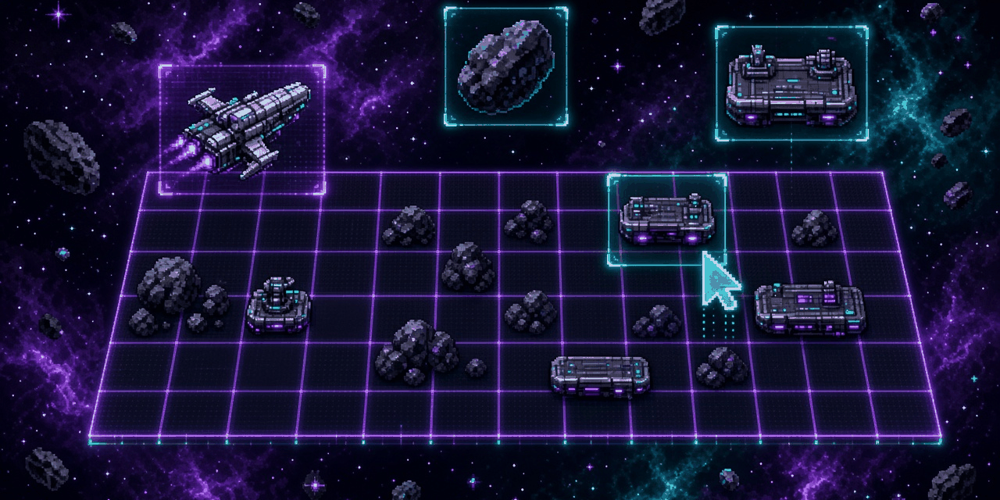
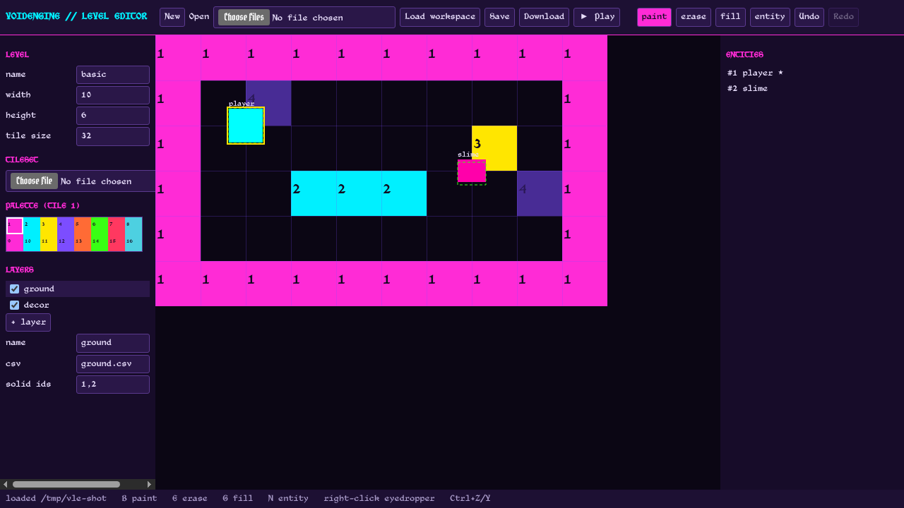

# VoidEngine Level Editor

A small visual level editor for [VoidEngine](https://github.com/Blackshield-Company/voidengine) (Odin + SDL2) 2D games.
You paint tilemaps, place entities with components, and set collision layers. The editor saves the engine's CSV
tilemap format plus a `level.json` sidecar. **Play** runs the level in a VoidEngine window that hot-reloads on every save.



> Status: first MVP. 2D tilemaps only.

## What's here

| Path | What |
| --- | --- |
| `editor/` | Web editor (React + TypeScript + Vite, plain Canvas 2D, no game framework) |
| `schema/level.schema.json` | The single `level.json` schema (version 1). The editor and the Odin loader are both tested against it |
| `odin/voidlevel/` | Odin package that loads `level.json` and its CSV layers into engine `Tilemap`s and spawns entities into a `Scene` |
| `examples/level_demo/` | VoidEngine example that renders a level and hot-reloads it when the file changes |
| `fixtures/basic/` | Shared fixture used by the TypeScript and Odin tests |

## Editor features

- Tileset PNG + tile size. The palette is cut from the sheet; tile ids are 1-based and 0 means empty, as in the engine. Without a tileset you get numbered placeholder colors.
- Paint (with gap-free drag), erase, flood fill, and a right-click eyedropper
- Multiple layers, each its own CSV, with visibility and per-layer `solid_ids`
- Lossless CSV load/save. Line endings and the trailing newline are kept, so round-trips are byte-identical
- Entities: click to place, drag to move, Delete to remove. The inspector edits name, spawn flag, position, sprite (size, color) and collider (size, offset, layer, mask from the engine's `CollisionLayer` enum)
- Undo/redo (Ctrl+Z / Ctrl+Y). Shortcuts: B paint, E erase, G fill, N entity
- Open `level.json` + CSVs, or import one bare tilemap CSV. Download writes the files back out

## Quick start

Needs Node 20+, Odin (tested with `dev-2026-09`), SDL2, and a VoidEngine checkout. The default checkout path is `../voidengine`.

```sh
git clone https://github.com/Blackshield-Company/voidengine ../voidengine   # if you don't have it
cd editor && npm install && npm run dev
```

Open the URL that Vite prints. The dev server works out of one workspace directory: `levels/sandbox/` by default
(override it with `VLE_LEVEL_DIR=/path/to/level`). The first run seeds that directory from `fixtures/basic`.

- **Save** writes `level.json` and the CSVs to the workspace
- **▶ Play** saves, then runs `make play`, which builds `examples/level_demo` and opens the level. While the demo is running,
  later Play or Save clicks hot-reload the level in the running window instead of launching a new one

Point at another engine checkout with `make ... VOIDENGINE=/path/to/voidengine`.

## level.json (v1)

```json
{
  "version": 1, "name": "basic", "tile_size": 32, "width": 10, "height": 6,
  "tileset": { "path": "tiles.png", "columns": 8 },
  "layers": [{ "name": "ground", "csv": "ground.csv", "solid_ids": [1, 2], "visible": true }],
  "entities": [{
    "id": 1, "name": "player", "spawn": true, "x": 64, "y": 64,
    "sprite": { "width": 24, "height": 24, "color": [0, 255, 255, 255] },
    "collider": { "width": 24, "height": 24, "offset_x": 0, "offset_y": 0, "layer": "Player", "mask": ["Wall", "Enemy"] }
  }]
}
```

Entity `x`/`y` is the center in world pixels, which matches how the engine treats `Transform` + `Collider`. CSV paths are relative to `level.json`.

## Using levels in your game

```odin
import vl "path/to/odin/voidlevel"   // build with -collection:voidengine=<voidengine checkout>

lvl, err := vl.level_load("assets/levels/one/level.json")
if err != .None { /* Read_Failed, Parse_Failed, Bad_Version, Bad_Layer, Bad_Collision_Layer */ }
defer vl.level_destroy(&lvl)
spawn, has_spawn := vl.level_spawn(&lvl, scene)   // Transform + Sprite + Collider per entity
for l in lvl.layers do if l.visible do engine.tilemap_render(renderer, l.tilemap)
if vl.level_reload(&lvl) { /* file changed: respawn */ }
```

## Tests

```sh
make test              # Odin loader tests + editor (vitest) tests
make check-demo        # builds the example and loads the fixture headless
cd editor && npm run typecheck
```

The tests cover byte-exact CSV round-trips (the fixtures plus any `*.csv` under the engine's `examples/`), engine-compatible
CSV parsing, the paint/erase/fill tools, undo/redo, schema validation, the editor and engine `CollisionLayer` lists staying in
sync, and loading, spawning and error handling in the Odin loader.

## Roadmap

- Integrate into VoidEngine Studio (Tauri) as a panel, using Studio's build/run runner for Play
- Textured sprites per entity (sprite sheet + frame) and drawing the tileset in `level_demo`
- Diff-based undo and chunked rendering for large maps; rectangle and line tools
- Custom per-entity properties

## License

Apache-2.0, same as VoidEngine. See [LICENSE](LICENSE).
